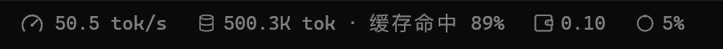
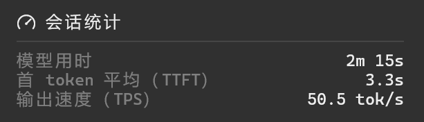
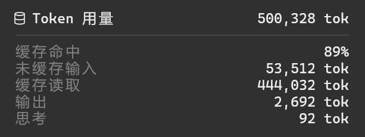
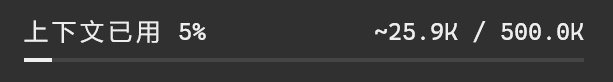

# OpenCode StatsPills

给 OpenCode V2 加一条轻量统计栏。不用展开侧栏，就能看到生成速度、Token 用量、缓存命中、费用和上下文占用。

[English](README.md) · **简体中文**









## 快速开始

已在 **OpenCode 2.0.26** 验证。需要 OpenCode V2、Node.js/npm 和支持鼠标的终端。详细的依赖与字体要求见[安装指南](docs/installation-zh.md)。

### 让 OpenCode 帮你安装

复制下面的提示词发给 OpenCode：

```text
请帮我安装 https://github.com/Henry-916/opencode-stats-pills 。

先阅读仓库的 README 和安装指南，再完成构建、插件启用及图标字体配置。安装时请：
- 检查 OpenCode V2 和所需依赖；缺少工具或版本不兼容时，说明需要处理什么。
- 将仓库放在固定目录，用构建产物的绝对路径创建本地插件入口。
- 合并现有配置，不覆盖其他设置、不重复添加插件，保留本地改动和会话。
- 如果已启用 opencode-tps-meter，禁用它的 TUI 部分，避免重复显示。
- 按实际终端配置图标字体，保留当前正文字体。

完成后检查构建产物、入口和启用配置，说明安装位置及需要重启的程序。不要为了验证安装发送模型请求；未完成的步骤请明确告诉我。
```

### 手动安装

见[安装指南](docs/installation-zh.md)。

## 怎么用

悬浮在指标上会高亮，点击打开详情。按 **Esc** 或点击外部关闭。

| 指标 | 详情 |
| --- | --- |
| 速度 | 模型用时、平均首 Token 延迟、生成速度 |
| Token | 缓存命中、输入、缓存读取、输出、思考 |
| 费用 | 当前会话、最近一轮对话 |
| 上下文 | 最近请求用量、模型窗口、进度条 |

主会话显示在输入框下方，子会话显示在 **Subagents / Shell** 面板上方。每个会话单独统计，不会把子会话用量加到主会话上。

速度包含思考 Token。`—` 表示没有时间和用量完整的生成速度样本。计算方式和数据限制见[统计口径](docs/metrics-zh.md)。

输出速度采用 DSH 的生成阶段加权平均口径：累计输出与思考 Token ÷ 首次输出到模型流结束的累计时长，不包含首 Token 等待和工具执行时间。

## 自定义价格

在 `cli.json` 的 `plugins` 数组中，将 `"opencode-stats-pills"` 替换为下面的对象，其他配置保持原样：

```json
{
  "package": "/absolute/path/to/opencode/plugins/stats-pills",
  "options": {
    "prices": {
      "your-provider-id": {
        "your-model-id": {
          "input": 1.0,
          "output": 2.0,
          "cacheRead": 0.1
        }
      }
    }
  }
}
```

`package` 填安装时创建的本地插件目录的绝对路径（目录内有 `tui.ts`），例如 Windows 的 `C:/Users/你的用户名/.config/opencode/plugins/stats-pills`。不要填插件 ID `opencode-stats-pills`：OpenCode 2.0.26 按 ID 启用已发现的插件时不会传递 options。

价格单位为 **美元 / 百万 Token**。示例价格仅用于说明格式，请填写自己的供应商 ID、模型 ID 和价格，然后重启 OpenCode。

`input` 和 `output` 必填；思考按输出价格计算，缓存写入按输入价格计算。`cacheRead` 对应缓存读取；没有缓存读取用量时可以省略，有用量却未配置价格时费用显示 `—`。免费项目填 `0`。

自定义价格优先于 OpenCode 的费用，未配置的模型使用宿主费用。费用 pill 位于 Token 和上下文之间，点击查看当前会话与最近一轮对话的费用。修改价格会重新计算已有请求，金额是估算值，不是账单。

Token 用量和会话费用汇总会话中的模型与压缩请求，不包含自动生成标题的用量。历史记录不完整或请求缺少价格时显示 `—`。主会话和子会话分别计算。

## 参与贡献

**欢迎提 PR**：修复 bug、适配终端、翻译和补充文档。小改动可以直接提交；较大的改动请先开 issue 讨论。

开发步骤和提交要求见 [CONTRIBUTING.md](CONTRIBUTING.md#简体中文)。

反馈 bug 请附 OpenCode 版本、操作系统、终端和复现步骤。

## 致谢

界面设计参考 DeepSeek Harness（DSH）的 StatsPills。

## 许可证

[MIT](LICENSE)。
