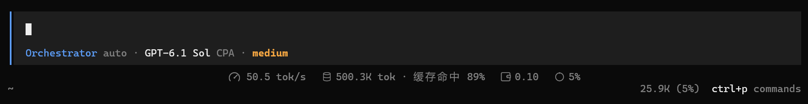
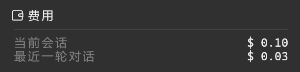

# OpenCode StatsPills

给 OpenCode V2 加一条轻量统计栏。不用展开侧栏，就能看到生成速度、Token 用量、缓存命中、费用和上下文占用。

[](LICENSE)
[](https://opencode.ai)

[English](README.md) · **简体中文**



## 功能


- **速度**：流式输出速度（tok/s）、模型用时、平均首 Token 延迟
- **Token**：总用量和缓存命中率，以及输入、缓存读取、输出、思考的明细
- **费用**：当前会话和最近一轮对话，可按模型自定义价格
- **上下文**：模型上下文窗口的占用，算法与 OpenCode 官方一致
- 点击任意指标查看详情；主会话和子代理会话分别统计
- 不装额外字体也能用；自定义图标为可选项

> [!NOTE]
> 界面文字目前为中文，欢迎贡献翻译。

## 环境要求

- **OpenCode V2**（已在 **2.0.29** 验证，不支持 V1）
- Node.js 和 npm，用于从源码构建
- 支持鼠标的终端

## 安装

### 让 OpenCode 帮你安装

复制下面的提示词发给 OpenCode：

```text
请帮我安装 https://github.com/Henry-916/opencode-stats-pills 。

先阅读仓库的 README 和安装指南，再完成构建和插件启用。安装时请：
- 检查 OpenCode V2 和所需依赖；缺少工具或版本不兼容时，说明需要处理什么。
- 将仓库放在固定目录，用构建产物的绝对路径创建本地插件入口。
- 合并现有配置，不覆盖其他设置、不重复添加插件，保留本地改动和会话。
- 如果已启用 opencode-tps-meter，禁用它的 TUI 部分，避免重复显示。
- 保留当前终端和字体设置。

完成后检查构建产物、入口和启用配置，说明安装位置及需要重启的程序。不要为了验证安装发送模型请求；未完成的步骤请明确告诉我。
```

### 手动安装

构建插件，创建指向构建产物的本地 TUI 入口，再在 `cli.json` 中启用。详细步骤和可选的自定义图标见[安装指南](docs/installation-zh.md)。

## 使用

主会话里，统计栏在输入框下方；子代理会话里，统计栏在 **Subagents / Shell** 面板上方。

鼠标悬浮在指标上会高亮，点击打开详情。按 **Esc** 或点击外部关闭。

<table>
  <tr>
    <td width="50%"><b>速度</b>：模型用时、平均首 Token 延迟、生成速度<br></td>
    <td width="50%"><b>Token</b>：缓存命中、未缓存输入、缓存读取、输出、思考<br></td>
  </tr>
  <tr>
    <td width="50%"><b>费用</b>：当前会话、最近一轮对话<br></td>
    <td width="50%"><b>上下文</b>：最近请求用量、模型窗口、进度条<br></td>
  </tr>
</table>

每个会话单独统计，子代理会话的用量不会加到主会话上。

### 统计口径

- **速度**只统计能观察到生成过程的输出：从流式思考或首批正文开始，到模型流结束之间生成的 Token ÷ 这段时长。不包含首 Token 等待、没有返回文本的思考和工具执行时间。
- **Token 和费用**汇总会话中的模型请求和压缩请求，不包含自动生成标题的用量。
- **`—`** 表示暂时没有可靠的数据可显示，例如只有工具调用和短思考的步骤、只有一批增量的回复、历史记录不完整或请求缺少价格。插件不会估算缺失的值。

每项指标的计算方式和数据限制见[统计口径](docs/metrics-zh.md)。

## 配置

### 自定义价格

默认使用 OpenCode 自己计算的费用。如果想用自己的价格，在 `cli.json` 的 `plugins` 数组中，将 `"opencode-stats-pills"` 替换为下面的对象，其他配置保持原样：

```json
{
  "package": "/absolute/path/to/opencode/plugins/stats-pills",
  "options": {
    "prices": {
      "your-provider-id": {
        "your-model-id": {
          "input": 1.0,
          "output": 2.0,
          "cacheRead": 0.1
        }
      }
    }
  }
}
```

- `package` 填本地插件目录的绝对路径（目录内有 `tui.ts`），例如 Windows 的 `C:/Users/你的用户名/.config/opencode/plugins/stats-pills`。不要填插件 ID `opencode-stats-pills`：OpenCode 2.0.26 按 ID 启用已发现的插件时不会传递 options。
- 价格单位为 **美元 / 百万 Token**。示例价格仅用于说明格式，请填写自己的供应商 ID、模型 ID 和价格，然后重启 OpenCode。
- `input` 和 `output` 必填；思考按输出价格计算，缓存写入按输入价格计算。
- 没有缓存读取用量时可以省略 `cacheRead`；有用量却未配置价格时，费用显示 `—`。免费项目填 `0`。

自定义价格优先于 OpenCode 的费用，未配置的模型继续使用宿主费用。修改价格会重新计算已有请求。金额是估算值，不是账单。

## 参与贡献

**欢迎提 PR**：修复 bug、适配终端、翻译和补充文档。小改动可以直接提交；较大的改动请先开 issue 讨论。

开发步骤和提交要求见 [CONTRIBUTING.md](CONTRIBUTING.md#简体中文)。反馈 bug 请附 OpenCode 版本、操作系统、终端和复现步骤。

## 致谢

界面设计参考 DeepSeek Harness（DSH）的 StatsPills。

## 许可证

[MIT](LICENSE)
